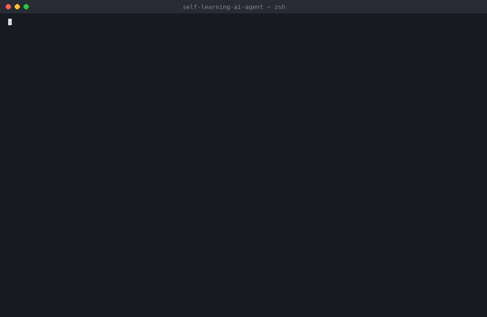
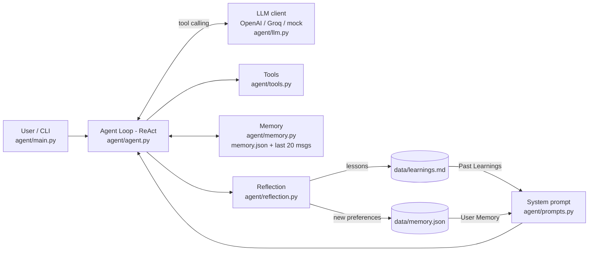

# 🧠 self-learning-ai-agent

A **self-learning AI agent** built from scratch in plain Python. It uses no LangChain, no CrewAI and no agent framework, only `openai` + `pydantic` + `python-dotenv`.
After every task it reflects on what went well and what went wrong, writes reusable lessons to `data/learnings.md`, and injects those lessons into its system prompt on the next task, so it **stops repeating its own mistakes**.


<!-- Rendered from a real `--eval` run with the offline mock provider. -->

---

## What is a Self-Learning Agent?

| | Normal agent | Self-learning agent (this repo) |
|---|---|---|
| Memory between runs | None (or chat history only) | Long-term `memory.json` (name, preferences, facts) |
| After a task | Forgets everything | Reflects: *what went well / wrong / rule for next time* |
| Mistakes | Repeats the same tool error every run | Writes a lesson to `learnings.md`, avoids the error next time |
| Prompt | Static | System prompt includes **Past Learnings** + **User Memory** |
| Preferences | Re-stated every time | Learned and saved (e.g. "likes tea") |
| Measurable? | Rarely | Built-in eval: run 1 vs run 2 score |

---

## Architecture



```
User ──► Agent Loop (Think → Act → Observe, max 10 steps)
              │            ├──► Tools: search_web · read_file · write_file · send_email*
              │            │           create_calendar_event* · get_user_preference · save_to_memory
              │            └──► Memory: memory.json (long-term) + last 20 messages (short-term)
              ▼
         Reflection ──► learnings.md ──► injected as "Past Learnings" in the NEXT task
                    └─► memory.json (new preferences/facts)
   * = needs the user's confirmation, enforced in the tool layer (not just by asking the LLM)
```

| File | Responsibility |
|---|---|
| `agent/agent.py` | ReAct loop with OpenAI function calling, error recovery, blocks repeated failing calls, max 10 steps |
| `agent/tools.py` | 7 Pydantic-validated tools, sandboxed file access, confirmation gate, mock email/calendar |
| `agent/memory.py` | `load_memory / save_memory / add_fact / add_preference`, short-term window of 20 messages |
| `agent/reflection.py` | Post-task reflection → 1–3 lessons → `learnings.md` (deduped) → memory updates |
| `agent/prompts.py` | System prompt (Past Learnings, confirmation rule, "don't repeat errors") + reflection prompt |
| `agent/llm.py` | Switchable provider: `openai` (gpt-4o-mini), `groq` (llama-3.3-70b-versatile), `mock` (offline) |
| `agent/config.py` | `.env` loading, data-dir paths, provider auto-selection |
| `agent/main.py` | CLI + evaluation harness |

---

## How to Run

```bash
pip install -r requirements.txt
cp .env.example .env          # add OPENAI_API_KEY or GROQ_API_KEY
python agent/main.py --task "Send email to John about meeting tomorrow at 11 AM"
```

Switch the provider with `LLM_PROVIDER=openai|groq|mock` in `.env`, or with `--provider`. With no key set, the agent falls back to the **offline mock**.

```bash
python agent/main.py --task "What is my name?"
python agent/main.py --task "Save that I like tea"
python agent/main.py --task "Create a calendar event called Standup tomorrow at 9 AM"
python agent/main.py --task "..." --yes      # auto-approve email/calendar confirmations
python agent/main.py --task "..." --json     # machine-readable result
python agent/main.py --eval                  # run 10 tasks twice: without vs with learnings
./run.sh --eval                              # same, via the wrapper
./test.sh                                    # full offline test suite
```

Emails and calendar events are **mocks**. They are written to `data/sent_emails.json` and `data/calendar.json` and never actually sent. `read_file`/`write_file` are sandboxed to `data/workspace/`, and `.env` can never be read.

---

## Example: Before Learning vs After Learning

Same task, two runs. These are real outputs, produced with the offline mock provider:

**Run 1: no lessons yet.** The agent tries to email a bare name, gets an error, recovers, and learns:
```
→ send_email {"to":"John", ...}
← error: ERROR: 'John' is not a valid email address. If you only have a contact name, look up ...
→ get_user_preference {}
→ send_email {"to":"john@example.com", ...}      (user approves)
Steps: 4 | Tool calls: 3 | Tool errors: 1
Lesson: When only a contact name is given, call get_user_preference first to look up
        their email address before calling send_email.
```

**Run 2: the lesson is in "Past Learnings".** The mistake is gone:
```
Using 1 past learning(s)
Thought: Past Learnings say to look up a contact's email first ...
→ get_user_preference {}
→ send_email {"to":"john@example.com", ...}      (user approves)
Steps: 3 | Tool calls: 2 | Tool errors: 0
```

**Eval (`--eval`, mock provider):**
```
Run 1 (without learnings): 6/10 passed
Run 2 (with learnings): 10/10 passed
Improvement: +4
```
A task passes only if it produces the right outcome **with zero tool errors**. Run 1 recovers from its mistakes but still makes them. Run 2 avoids them because of the lessons. Two hidden constraints are learned this way. `create_calendar_event` only accepts ISO-8601 times, and its schema deliberately doesn't say so. `send_email` needs a real address, but contacts are stored in memory facts.

### ⚠️ Honest notes on the mock and real LLMs
- The **mock provider is a rule-based simulation**. It reads the Past Learnings section and changes its plan when it finds a relevant lesson. That makes the learning loop testable offline and deterministic, but the mock's "intelligence" is scripted. The 6/10 → 10/10 result proves that the **plumbing** works: reflection → `learnings.md` → prompt injection → changed behaviour. It does not show how much a real model improves.
- With **gpt-4o-mini or Llama-3.3-70B** the same code runs unchanged, but the score gain is **not guaranteed**. A strong model may guess the ISO format on the first try, so run 1 and run 2 can tie. Real-LLM results vary from run to run.
- The real OpenAI SDK path is covered by `test.sh` against a local OpenAI-compatible server (`tests/fake_openai_server.py`). It was **not** run against the live OpenAI/Groq APIs in this build, because no key or network access was available.

---

## Tests

`./test.sh` runs offline in throwaway data dirs, so your `data/` folder is never touched:

1. `--task "What is my name?"` → returns **Jewel** from `memory.json`
2. `--task "Save that I like tea"` → `memory.json` updated
3. `--task "Send email to test@test.com"` → shows the confirmation prompt; declining saves nothing, approving saves to `sent_emails.json`
4. `--task "Create calendar event"` → saved to `calendar.json`
5. Same task twice → run 1 has 1 tool error, run 2 loads the lesson and has 0
6. `--eval` → 10 tasks × 2 runs, prints scores, run 2 > run 1, no crash
7. No API keys in code (regex scan), keys only from `.env`
8. Real `openai` SDK tool-calling loop against a local OpenAI-compatible server

Current result: **18/18 checks pass**.

---

## Design choices beyond the brief
- **7th tool `save_to_memory`**, so "Save that I like tea" is an explicit and reliable action. Reflection *also* picks up preferences the user stated.
- **Confirmation is enforced in code.** `send_email` and `create_calendar_event` call a confirm callback before any side effect, so a model that "forgets" to ask can't bypass it.
- **Repeated identical failing calls are blocked.** The loop also appends a "re-plan" note to every error, which implements "don't repeat the same error" at runtime as well as in the prompt.
- **Lessons are deduplicated.** The newest 30 unique lessons are injected, which keeps the prompt bounded.
- **Built with a plan → parallel subagents → integration workflow.** See `PLAN.md` for the contracts.

---

## What I Learned
- **"Self-learning" doesn't need fine-tuning.** A reflection step plus a persistent lessons file plus prompt injection gives measurable behaviour change, and the loop is cheap, inspectable and easy to reset by deleting `learnings.md`.
- **Lessons must be general and short.** "Convert times to ISO 8601 before calling create_calendar_event" transfers to new tasks. "The Standup event failed" doesn't.
- **Evaluation needs a strict definition of success.** Checking only the outcome hides learning, because agents usually recover from errors anyway. Counting tool errors and steps makes the improvement visible.
- **Safety belongs in the tool layer.** Prompts are suggestions. Confirmation gates, path sandboxing and `.env` blocking are guarantees.
- **Keep the LLM behind one small interface** (`chat(messages, tools, json_mode)`). That's what made OpenAI ↔ Groq ↔ offline mock a one-line switch and made the whole system testable without an API key.
- **Learned memory can go stale or wrong.** A bad lesson is injected into every future prompt, so lessons need review, dedupe and a cap.
